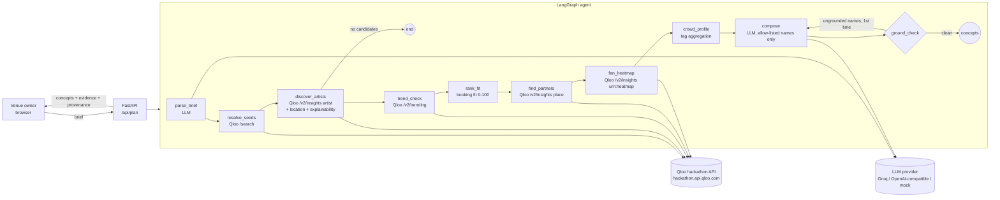

# Encore — a booking agent with taste

**Encore helps independent venues fill their quiet nights.** A bar, café or small club describes itself in plain language and names a few artists its regulars already love. Encore reads Qloo's taste graph for that city, finds acts and co-promotion partners with measurable affinity to that crowd, checks each act's momentum, and drafts complete event concepts. It refuses to name any act or business that Qloo did not return.

Built for the [Qloo Agentic Hackathon](https://qloo.devpost.com/) (2026).


**What the booker gets:** 2–3 event concepts. Every act carries a transparent **Booking Fit score**, a
**taste bridge** showing which of the regulars' artists pulls toward it (Qloo explainability), and a
**fan heatmap** marking the 3 parts of the city where the lineup's fans concentrate, so promo money goes there.
The whole plan exports as a booking memo.

| Taste bridge | Where your next crowd lives |
|---|---|
|  |  |

_Screenshots: live Groq LLM, Qloo in labelled fixture mode (fictional names, synthetic grid) until the hackathon key arrives._

## Why it needs Qloo

Ask a general LLM to book a Thursday night for a 120-capacity Hyderabad rooftop whose crowd loves Anoushka Shankar, Prateek Kuhad and Khruangbin. You get plausible names with no evidence. In our own test run (Groq, `openai/gpt-oss-120b`) it suggested booking Prateek Kuhad himself, an act the crowd already knows and not a small-budget booking. Encore instead:

| Step | Qloo call | What it gives the venue |
|---|---|---|
| Resolve the crowd's artists | `GET /search?types=urn:entity:artist` | Stable entity IDs instead of fuzzy names |
| Find acts this crowd will like, near them | `GET /v2/insights?filter.type=urn:entity:artist&signal.interests.entities=…&signal.location.query=<city>&feature.explainability=true` (+ `filter.popularity.max=0.9` on a budget) | Affinity per act, plus *which* of the crowd's artists drives each pick |
| Check momentum | `GET /v2/trending` (8-week window) per top candidate | Rising / steady / cooling, so you book acts on the way up |
| Find co-promotion partners | `GET /v2/insights?filter.type=urn:entity:place&signal.interests.entities=<chosen acts>&filter.location.query=<city>` | Local cafés, bars and shops whose audience overlaps with those acts' fans (cross-domain) |
| Rank by booking fit | deterministic, from the signals above | 0–100: 45% affinity · 20% momentum · 20% budget fit (popularity as a fee proxy, *stated assumption*) · 15% bridge (how evenly the act draws on all the regulars' artists, from explainability) |
| Map where the fans are | `GET /v2/insights?filter.type=urn:heatmap&filter.location.query=<city>&signal.interests.entities=<top 3 acts>` | Affinity grid for the city and the 3 strongest separated hotspots with map links, so promo goes where the fans are |
| Taste profile | aggregated from the tags on the above results | The crowd's shared genres and audiences, in plain view |

The LLM only does two jobs: it parses the brief and writes the concepts. A deterministic `ground_check` node then removes any act or partner the LLM named that is not in Qloo's results, and sends the writer back for one retry if it had to remove something.

## Architecture



Every run returns a provenance table: each Qloo call's endpoint, parameters (never the key), source (`live` or `fixture`), result count and latency. The UI shows it.

## Run it

```bash
python -m venv .venv && source .venv/bin/activate
pip install -r requirements.txt
cp .env.example .env    # then fill in keys, or leave blank for offline mode
export $(grep -v '^#' .env | xargs)   # or use your own env loader
uvicorn encore.main:app --reload
# open http://localhost:8000
```

Docker: `docker build -t encore . && docker run -p 8000:8000 --env-file .env encore`
Render (free tier): `render.yaml` is included. Set `QLOO_API_KEY` and `GROQ_API_KEY` in the dashboard.

### Modes

| Env | Effect |
|---|---|
| `QLOO_API_KEY` set | **Live Qloo** at `https://hackathon.api.qloo.com`, header `X-Api-Key`, GET only, no legacy `/recs` |
| `QLOO_API_KEY` empty | **Fixture mode**: a synthetic universe of clearly fictional artists and places (`encore/fixtures/universe.json`). A banner says so on every page. Not Qloo data. |
| `GROQ_API_KEY` set | Groq free tier, model `openai/gpt-oss-120b` (override with `LLM_MODEL`) |
| `LLM_PROVIDER=openai_compat` | Any OpenAI-compatible endpoint (`LLM_BASE_URL`, `LLM_API_KEY`) |
| no LLM key | Deterministic template writer, so the agent and tests run offline |

Get a Qloo hackathon key with the form linked from the [developer guide](https://docs.qloo.com/reference/qloo-llm-hackathon-developer-guide#getting-your-api-key).

## Tests

```bash
pytest -v
```

19 tests cover the Qloo request shape (including the documented heatmap request: `filter.type=urn:heatmap`, `filter.location.query`, `signal.interests.entities`), the booking-fit maths, bridge score and hotspot separation, the Qloo request shape (base URL, `X-Api-Key` header, GET, comma-joined IDs, key never in the URL), 401/403 handling, legacy-endpoint blocking, caching, fixture labelling, the full graph end to end, the grounding check stripping hallucinated names and retrying once, the Groq request shape, and the HTTP API.

## API

- `GET /api/health` → `{qloo_mode, llm_provider, llm_model}`
- `POST /api/plan` `{"brief": "..."}` → profile, seeds, crowd tags, candidates, partners, concepts (with evidence), removed names, warnings, agent trace, Qloo provenance
- `POST /api/baseline` `{"brief": "..."}` → the same brief answered by the LLM alone, for comparison

## Responsible use

Qloo results describe aggregate taste affinities. Encore sends Qloo only artist names and a city, never personal data. Affinity and explainability scores are shown as Qloo's signals, not as predictions about any individual. Qloo responses are cached in process memory only and are never written to this repository.

## Limits

- Fixture mode demonstrates the flow, not real recommendations.
- Trending needs Qloo history for an act. Where that's missing, Encore shows no momentum rather than guessing.
- Encore does not check artist availability, fees or contracts. It shortlists; the venue books.

## License

MIT, see [LICENSE](LICENSE).
